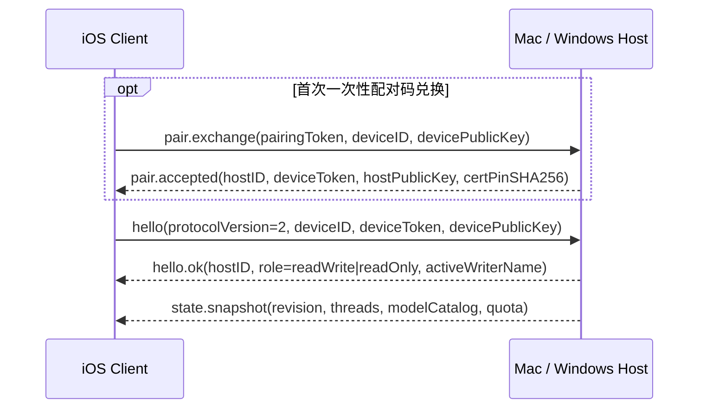

# Micro Remote Protocol · v2（兼容 v1）

完整版本化规范与 JSON Schema 见：

- [Micro Remote Protocol v2 规范](../../protocols/micro-remote/README.zh-CN.md)
- [Micro Remote Protocol v2 JSON Schema](../../protocols/micro-remote/schema.v2.json)
- [Swift 共享协议与账本包 (`packages/MicroRemote`)](../../packages/MicroRemote/Sources/MicroRemote/MicroRemoteProtocol.swift)
- [Windows Host 协议与服务 (`src/CodexMicro.Remote`)](../../src/CodexMicro.Remote/MicroRemoteProtocol.cs)

## 1. 传输与两套外网连接方案

- **方案 A（Tailscale 组网直连）**：iOS 与桌面端 Host 建立 WSS 连接（默认端口 `48720`，路径 `/ws/micro`）。首次扫码配对通过 `codexmicro://pair` URI 中的 `pin`（叶证书 DER SHA-256 指纹）完成证书固定校验，随后发送 `pair.exchange` 兑换长期 `deviceToken`。
- **方案 B（Micro 自建公网中继 + 端到端加密）**：iOS 与桌面端 Host 分别向公网 Relay（`services/relay/`，路径 `/ws/relay`）发起出站 WSS 连接。所有业务 JSON 帧封装在 `relay.envelope` 中，使用双方配对绑定的 Curve25519 公钥经 `HKDF-SHA256` 派生会话密钥，采用 `ChaCha20-Poly1305` 进行应用层端到端认证加密；Relay 仅路由外层元数据（`hostID`、`deviceID`、`sessionID`、`seq`），不解密业务载荷。

## 2. 握手、配对与控制权租约

- 每个 Host 同时仅授予一台已认证设备 `readWrite` 写租约，其余连接处于 `readOnly` 观察模式。
- 只读设备可显式发送 `session.takeover` 接管写权限，Host 通过 `session.lease` 广播最新租约归属。
- 电脑端撤销设备时，Host 立即下发 `auth.revoked` 并断开连接；iOS 停止自动重连并提示权限已吊销。

## 3. 状态快照、完整任务列表与按需详情

- `state.snapshot`：返回 `revision`、`hostID`、`hostName`、`hostPlatform`、`snapshotUpdatedAtMs`、`keypadSlotCount`、`selectedThreadID`、`modelCatalog`、`quota`（含 5h / 7d 剩余比例与重置进度）、`threads`（6 / 14 键位任务，支持 `idle`、`running`、`completed`、`waiting`、`question`、`error`、`overloaded`、`unknown` 与 `hasDraft` 标记）以及 `totalThreadCount`。未知的 `fastMode` / `planMode` 保持 `null`，不伪装为 `false`。
- `threads.list` / `threads.list.result`：支持 `query` 关键字过滤与 `cursor` / `limit` 分页浏览全部任务。
- `thread.detail.read` / `thread.detail.result`：按需读取指定任务的 `latestReply`（最近一条完整助手回复正文）、`approvals`（全部待审批项，含 `kind`、`summary`、`commandText`、`cwd`、`filePaths`、`approvalContentHash`）、`pendingQuestions` 与 `canSubmitText`。

## 4. 命令账本与断线结果确认

所有写命令携带客户端生成的 `requestID` 与规范化 `payloadHash`：

| 命令 `type` | 关键参数与安全校验 |
| --- | --- |
| `thread.select` | `threadID`, `openInDesktop` |
| `settings.setModel` | `threadID`, `model`, `effort`（可选） |
| `settings.setEffort` / `settings.stepEffort` | `threadID`, `effort` 或 `delta` |
| `settings.setFastMode` / `settings.setPlanMode` | `threadID`, `enabled` |
| `approval.accept` / `approval.decline` | `threadID`, `approvalRequestID`, `approvalContentHash`（内容哈希不一致则拒绝） |
| `turn.stop` | `threadID`, `turnID`（仅停止匹配的活跃回合） |
| `turn.sendText` | `threadID`, `text`（仅向空闲会话显式发送文字，绝不提交桌面输入框草稿） |

- Host 在调用底层控制层前，先将 `(deviceID, requestID, payloadHash)` 以 `in_progress` 写入持久化命令账本（macOS SQLite `MicroRemoteStoreDB` / Windows `RemotePersistentStore`）。
- 若执行期间 Host 崩溃重启，启动恢复逻辑将遗留的 `in_progress` 记录标记为 `unknown`。
- 客户端断线重连后发送 `command.queryResult` 查询未决请求，绝不自动重放写命令。无法证明结果的请求保持 `unknown`，仅锁定对应 `(hostID, threadID)` 的冲突写操作，并提供显式解锁恢复入口。
