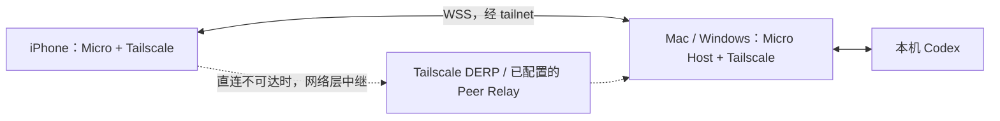
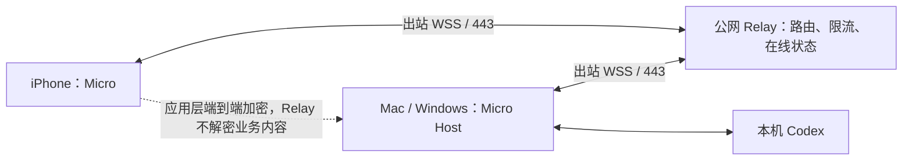

# Codex Micro iOS：需求与技术选型规划

日期：2026-10-21（America/Los_Angeles）

状态：已完成首版代码实现并通过编译构建验证（iOS `CodexMicro`、macOS `MacRemoteHost`、Windows `CodexMicro.Remote`、共享包 `MicroRemote` 与中继服务 `CodexMicro.Relay`）；真机与蜂窝外网联调待验收。源码基线：产品仓库 `4e83405`。

## 1. 已确认范围与建议

用户已确认：启动 iOS 产品规划；**首版同时支持 Mac、Windows，并支持外网访问**；允许额外安装组网工具；外网连接需要比较两种方案。

建议定位为电脑上 Codex 的手机控制面：查看任务、处理审批、调整模型与强度、停止任务，以及发送明确的补充指令。电脑继续执行任务，手机负责观察和操作。首版以 iPhone 为主，兼容 iPad；沿用 UIKit 与现有 Micro 设计。

外网分为两套可独立交付的方案：

- **方案 A：Tailscale 组网 + Micro Host 直连。** 推荐作为首版，减少公网基础设施工作。
- **方案 B：Micro 配对 + 自建公网中继。** 用户只安装 Micro，产品承担设备连接、服务运维和端到端加密。

“Mac、Windows 同时支持”指两端都通过相同核心需求验收；开发可以顺序推进，首版发布不能只交付其中一端。两种网络方案共用需求和业务协议，分别评估成本；本规划不把“两种方案”解释为首版必须同时实现两条网络链路。

尚未确认的产品项采用以下规划假设，可独立调整：后台推送列为 P1；先完成开发签名设备内测，再准备 TestFlight；完整聊天、文件管理、代码编辑不进入首版。

## 2. 仓库现状与复用边界

| 部分 | 已有证据 | 本次处理建议 |
| --- | --- | --- |
| iOS 界面 | `apps/ios` 有 UIKit、4×4 键位、6 / 14 任务槽、旋钮、灯效、DEMO | 复用控件和绘制；补真实连接、详情和手机操作流 |
| iOS 网络 | `WebSocketTransport` 有 WSS、握手、租约、全量快照、回执；凭据存 Keychain | 保留传输基础，升级版本协商、重连、多 Host、分页和消息模型 |
| iOS 未决操作 | 保存未决请求，重连只查询；当前一个未知结果会阻塞全部写操作 | 保留不重放原则，改为按 Host / 任务约束冲突操作，并设计恢复入口 |
| macOS | Swift `DesktopBackend` / `CodexClient`、App Server、Desktop IPC、AppKit 桥接 | 新增网络入口，复用同一执行和观察路径；实现不等于远程验收通过 |
| Windows | `codex-control` 有列表、设置、文本发送、停止、审批等公开操作；产品侧有 UI / 状态整合 | Host 调用固定版本组件与产品状态服务，不复制私有控制实现 |
| 远程 Host | 两端均没有供该 iOS 原型使用的完整网络 Host | 两端均需新增配对、会话、状态订阅、权限、命令账本和打包支持 |

现有 iOS 仍有单 Host、每次启动进入 DEMO、最多显示 14 个任务、单审批摘要等限制。旧 `PROTOCOL.md` 不含手机文本发送，也未接入后台推送。Mac 近期新增的未读、草稿、过载状态、Credit 额度等不能假定已同步到 iOS。

代码依据：[iOS 原型](../../apps/ios/README.md)、[v0.1 协议](../../apps/ios/PROTOCOL.md)、[macOS 能力范围](../../apps/macos/README.md)、[共享控制合同](../../../codex-control/src/CodexControl/CodexControlContracts.cs)。历史 [UIKit 架构](ios-uikit.zh-CN.md) 用于理解旧代码，新范围以本文为准。

## 3. 需求范围

### 3.1 关键使用流程

1. 电脑打开 Micro 并启用远程连接，手机扫码配对；保存电脑身份和独立设备凭据。
2. 手机切到蜂窝网络，选择 Mac 或 Windows 电脑，看到最新任务与额度。
3. 选择某个任务，查看必要上下文，执行一项操作，看到已确认结果或待确认状态。
4. 切换网络、锁屏再返回、Host 重启后恢复状态；已发出的操作不会因为重连再次执行。
5. 丢失手机或停止使用时，在电脑撤销该设备；撤销即时影响现有连接和后续连接。

### 3.2 P0：首版共同需求

| 编号 | 需求 | 完成标准 |
| --- | --- | --- |
| R01 | 配对与设备管理 | 二维码配对、手动入口、重配、撤销；配对失败有明确原因；DEMO 与真实电脑清楚区分 |
| R02 | 多电脑 | 保存多个 Host；一次控制一个；切换电脑清空旧选择和租约；同名任务不会串到另一台电脑 |
| R03 | 外网连接 | iPhone 蜂窝网络分别连接 Mac、Windows；至少方案 A 通过完整流程，不能以同 Wi-Fi 验证替代 |
| R04 | 任务监控 | 运行、完成、待审批、待回答、错误、过载、未知分别呈现；状态注明新鲜度；断线不保留实时灯效 |
| R05 | 任务选择 | 保留 6 / 14 个快捷槽；增加完整列表、搜索 / 分页；按稳定任务 ID 绑定，触摸期间不换位 |
| R06 | 模型、强度、Fast、Plan | 以 Host 当前目录和能力为准；执行后回读；未知值不伪装为关闭；不硬编码模型名单 |
| R07 | 停止回合 | 针对明确任务及当前 turn ID；回合已变化则拒绝旧命令，不能停止随后开始的新回合 |
| R08 | 单项审批 | 展示请求类型、命令 / 路径 / 变更等必要信息；列表选择具体请求；内容变化后重新确认；两端同时审批只应用一次 |
| R09 | 查看结果与发送文字 | 详情按需读取最近一条完整回复和当前请求上下文；明确向选定任务发送文字；待审批或运行时按能力限制；不提交电脑上不可见的输入框草稿 |
| R10 | 额度 | 允许额度未知；支持不同窗口、套餐显示差异及 Credit；电脑端归一化语义，手机负责呈现 |
| R11 | 断线恢复 | 前台退避重连；先认证、取快照和核对未决操作，再开放控制；手机重启保留未确认请求 |
| R12 | 结果可信 | 收到请求、执行完成、明确失败、结果未知分别处理；超时不能显示成功或擅自重试 |
| R13 | 运行边界 | Codex 未登录 / 退出、电脑休眠、权限不足、版本不兼容可辨识；不支持的动作保持禁用 |

R06–R09 是双端核心验收项。能力协商用于处理运行时缺失与平台差异，不能通过隐藏所有写操作把缺少能力的平台称为完成。若某项无法实现，需显式修订首版范围。

远程审批首版限定两端均可识别和核验的命令 / 文件审批。其他请求类型显示其类别并引导回电脑处理，不能强行转换成通用“批准”。待回答问题首版可查看，复杂问卷回答列为 P1。

### 3.3 后续范围

| 优先级 | 功能 | 原因 / 依赖 |
| --- | --- | --- |
| P1 | APNs 完成 / 待审批通知 | 两种外网方案都需独立推送服务；通知只提示，打开后重新核验 |
| P1 | Fork、电脑打开会话、最近历史分页、结构化问题回答 | 分别需要来源核验、桌面可用性、正文协议和问答合同 |
| P1 | 自定义键位、更多 iPad 布局、手机系统听写 | 在稳定控制流程上扩展；听写先形成可编辑文字，再显式发送 |
| P1 | Bonjour 局域网发现 | 减少手填地址；不能替代外网发现与身份认证 |
| P2 | 小组件、Live Activities、多 Host 同屏、团队设备共享 | 先解决刷新时效、权限和资源占用 |
| 暂不纳入 | 手机代码 IDE、任意终端、远程桌面视频、完整文件浏览、蓝牙链路、手机本地运行 Codex | 超出 Micro 手机控制面的首版范围 |

### 3.4 界面方向

不在主页增加说明性文案区。主视图仅保留电脑、连接状态、必要任务信息、键盘与设置入口；技术参数留在连接诊断中。

| 风格 | 取舍 |
| --- | --- |
| **Micro 键盘 + 原生详情叠层（推荐）** | 保留产品辨识度；连接、完整任务列表、审批和文字输入使用可读的原生叠层 |
| 任务列表为主 + 紧凑控制条 | 大量任务更易查找，键盘成为可切换视图 |
| iPad 双栏工作台 | 左侧任务、右侧控制和详情；适合平板，可后续增加 |

以上是候选，尚未锁定新视觉稿。沿用现有设计尺寸与资源；小屏最低触控目标按 44pt 设计，不能为了保留整机比例缩到难以操作。设置沿用“点哪设置哪”，编辑与执行使用不同入口。旋钮提供按钮 / VoiceOver 替代操作；状态不能只靠颜色表达。远程任务详情优先保留完整审批语义，显示截断时提供展开。

## 4. 外网方案 A：Tailscale 组网直连

**用户流程**：手机与电脑安装 Tailscale，加入有访问权限的同一 tailnet；电脑 Micro 显示连接二维码；手机扫码完成 Micro 设备配对。日后使用蜂窝网络时，保持 Tailscale 可用，打开 Micro 选择电脑即可。

**推荐实现**：Micro Host 在 Tailscale 地址上提供 WSS，手机使用该地址或完整 MagicDNS 名。Host 生成本机 TLS 身份，二维码包含证书指纹作为初次信任依据，手机不要求用户安装根证书。证书更换必须经过已认证的轮换流程或重新配对。Host 默认只开放选定网络接口，Windows 防火墙规则限定对应范围。

如用户环境适合，也可通过 Tailscale Serve 给本机回环监听提供 HTTPS / WSS 入口，减少证书管理；该部署方式需在双端验证 WebSocket 升级、授权头和长连接。Serve 的 tailnet 访问与 Funnel 的公网发布是不同范围，本方案不启用 Funnel。[Tailscale Serve](https://tailscale.com/docs/features/tailscale-serve)

Tailscale 提供 iOS、macOS、Windows 客户端；底层直连失败时可能经 Peer Relay 或 DERP，DERP 转发的是加密流量。因此“直连方案”描述的是产品没有自建业务中继，不保证每条网络路径都是 P2P。[下载平台](https://tailscale.com/download)、[DERP 机制](https://tailscale.com/docs/reference/derp-servers)

| 项目 | 方案 A |
| --- | --- |
| Micro 要新增 | 双端 Host、WSS、配对、设备权限、状态与命令协议、iOS 完整操作流程 |
| 由组网工具承担 | 网络身份、地址路由、NAT 穿透与网络层中继 |
| 产品服务器 | 控制与状态链路不需要自建服务器；后续 APNs 另计 |
| 身份边界 | 同 tailnet 可达不代表有 Micro 操作权限，仍验证每台手机的配对凭据 |
| 主要成本 | 安装 / 登录组网工具、企业 VPN 共存问题、网络排障、双端 Host 维护 |
| 适用人群 | 自用、开发者、小规模内测，能接受额外工具的用户 |

需要预研：iOS 已有 VPN 环境下的可用性；目标地区和运营商的实际连通性；IP / DNS 变化；Windows 防火墙；Tailscale 身份或节点到期。连接失败时区分“网络不可达”与“Micro 未授权”，不能仅据超时断言用户没开 VPN。

采用 Tailscale 公共证书时需处理续期，且证书透明度日志会公开相关主机域名；这是选择公共证书部署时的产品说明项。默认二维码指纹方案单独管理证书生命周期。[HTTPS 证书说明](https://tailscale.com/docs/how-to/set-up-https-certificates)

## 5. 外网方案 B：Micro 自建公网中继

**用户流程**：电脑启用 Micro 远程连接并连接 Relay；手机扫描电脑二维码；双方确认设备身份后建立配对。两端均主动向 Relay 建立出站连接，用户无需额外 VPN 或配置路由器端口。先走中继，不在首版同时开发 ICE / STUN / TURN 与 P2P 路径优化。

**技术建议**：Relay 使用 .NET 10 / ASP.NET Core WebSockets，作为独立 Linux 容器部署。先单实例，持久化设备公钥、授权关系和撤销状态；转发队列有界且仅存内存。扩展到多实例后再引入共享路由与数据库方案，不能假设增加副本就能让两个设备落在同一连接进程。

首版 B 可以使用“配对设备身份”，不必先自建邮箱、密码和完整账号系统；设备丢失时通过电脑撤销并重配。若面向托管服务或团队，另增成熟身份提供方、账号恢复和访问管理，不把账号登录自动等同于电脑控制授权。

**TLS 与端到端加密分开设计**：两条 WSS 都在 Relay 终止，仅有 TLS 时 Relay 能读业务数据。B 应在 WSS 内再建立手机到 Host 的认证加密会话，二维码绑定 Host 身份；Relay 只看到必要路由和连接元数据。优先评估 Noise 的成熟实现与 Swift / .NET 互操作，不自行拼装密码协议。具体库、握手模式、许可与维护状况在 B 的预研中冻结；目前不能声称已完成该选型。[Noise 协议框架](https://noiseprotocol.org/)

| 项目 | 方案 B |
| --- | --- |
| 相对 A 的新增 | Relay、Host 出站通道、设备身份握手、端到端加密、路由授权、限流与服务部署 |
| 配对 | 短期一次性材料绑定设备公钥；显示短码只能辅助查找和核对，不能成为全部认证依据 |
| 云端保存 | 必要设备关系、撤销记录和运行指标；不保存聊天、审批正文或离线操作队列 |
| 断线行为 | 重新路由、认证、同步；中继恢复不能自动重放命令 |
| 运维 | 域名、证书、服务器、流量、监控、升级、备份、滥用处理和故障响应 |
| 适用人群 | 不接受额外工具的用户、希望统一安装体验的公开产品 |
| 核心风险 | 密钥生命周期、跨端加密实现、服务可用性、跨区域延迟与持续运维成本 |

公网中继不能让休眠 / 关机的电脑执行任务。Relay 在线不等于 Host 在线，Host 在线也不等于 Codex 已就绪，客户端需要分别呈现。

## 6. 两套方案对比与选择

| 维度 | A：Tailscale | B：Micro Relay |
| --- | --- | --- |
| 用户安装 | Micro + Tailscale，两端均需要 | 只安装 Micro；部署方维护 Relay |
| 首次设置 | tailnet 登录 + Micro 扫码 | Micro 扫码 / 设备确认 |
| Mac / Windows | 均需 Host 适配 | 均需相同 Host 适配，再加出站通道 |
| NAT 与公网地址 | 组网工具处理 | 两端出站连接，不要求电脑公网地址 |
| 数据路径 | 经 tailnet，可能网络层中继 | 经 Micro Relay；需要应用层端到端加密 |
| 服务成本 | 无自建业务 Relay；第三方计划与限制按实际使用核对 | 有持续基础设施与运维成本 |
| 后台推送 | 需要额外 APNs 方案 | 同样需要 APNs，Relay 不替代推送 |
| 实现工作量 | 双端 Host + iOS + 组网适配 | A 的业务部分 + 中继与加密体系 |
| 建议顺序 | **先交付，验证远程需求和双端控制** | 当安装门槛成为问题，或明确要托管体验时推进 |

先统一 `HostIdentity`、`RemoteSession`、`StateStore` 与业务命令，把直接连接和 Relay 放在可替换传输层。B 上线时可能需要为已有设备补做密钥配对；不能承诺 A 的旧令牌无操作自动升级。切换传输必须重新认证和同步，保留原 request ID 查询结果，不产生新写操作。

## 7. 客户端与 Host 技术选型

| 层 | 推荐 | 原因与边界 |
| --- | --- | --- |
| iOS UI | Swift + UIKit + Core Animation | 沿用已实现控件与仓库方向；现阶段不重写 SwiftUI，也不引入 Flutter / React Native |
| 系统基线 | iOS / iPadOS 17+ 暂沿用 | 依赖 API 在该基线上验证；开发工具与上架 SDK 使用交付时 Apple 支持版本 |
| 状态架构 | MVVM + 单向更新；网络和账本用 actor，UI 用 MainActor | 从旧 `MicroStore` 拆出会话、设备、状态和命令职责；不为本轮引入大型状态框架 |
| 手机传输 | URLSessionWebSocketTask；JSON / Codable | 已有实现；双向状态、审批和命令能共享连接；保留协议版本与帧上限 |
| 设备发现 | 二维码优先；Bonjour / NWBrowser 后续 | 二维码适用于跨网初次配对，Bonjour 仅是局域网候选发现 |
| Mac Host | Swift + Network.framework；嵌入现有 Micro 后台能力 | `NWListener` / `NWProtocolWebSocket` 处理监听和帧；复用 `DesktopBackend`，不为 Mac 引入 .NET 运行时 |
| Windows Host | C# / .NET 10 + ASP.NET Core Kestrel | 复用已固定版本的 CodexControl；产品状态观察与动作队列保持单一入口 |
| 配对 / 密钥 | iOS、Mac Keychain；Windows 当前用户安全存储 | 长期凭据不写 UserDefaults 或日志；手机凭据不可自动跨设备迁移 |
| 命令账本 | Host SQLite；iOS 受文件保护的本地记录 | Host 在调用适配器前持久化 request ID 和状态；正文只按必要范围短期保存 |
| 配置 | 版本化 Codable / JSON | 非敏感界面偏好单独保存；配置按 Host / 账号范围隔离 |
| 共享层 | JSON Schema + Swift 小型本地 Package | 共用 DTO / 状态语义与 Apple 无平台依赖代码；C# 遵循相同合同，不假装可共享 Swift 运行时 |

Apple 的 URLSession 支持 WebSocket / TLS，Network.framework 提供服务端 WebSocket 握手回调；Windows 使用 ASP.NET Core 的 WebSocket 支持。这里仍需验证跨平台互通、身份校验和资源限制，并非已有 Host 的说明。[URLSession](https://developer.apple.com/documentation/foundation/urlsessionwebsockettask)、[Network.framework 握手](https://developer.apple.com/documentation/network/nwprotocolwebsocket/options/setclientrequesthandler(_:handler:))、[ASP.NET Core](https://learn.microsoft.com/en-us/aspnet/core/fundamentals/websockets?view=aspnetcore-10.0)

**Host 生命周期**：首版随当前登录用户的 Micro 运行，关闭面板后保持监听；退出 Micro 停止服务。Mac 使用现有原生桥接路径，Windows 保留交互用户上下文，避免把依赖桌面的能力直接搬进系统服务。网络入口与本地按钮进入同一目标校验 / 串行执行边界，防止两套执行器竞争。

**Codex 边界**：App Server 的官方接口可用于适配，但其 WebSocket 当前仍标为实验能力；官方文档不能证明独立启动的 App Server 可以接管桌面进程中的所有已有回合。现有 Desktop IPC 属于版本敏感边界，必须按实际 owner 和能力处理；不把它直接暴露给手机。这里选择 Micro Host 进行隔离，属于结合现有代码的架构判断。[OpenAI 官方 App Server 文档](https://learn.chatgpt.com/docs/app-server)

## 8. 远程协议与可靠性

现有 v0.1 保留为历史合同。新方案另建带主版本的协议，不在旧字段上静默改变类型。首版可先用分页全量快照与按需详情，增量更新通过能力协商启用，不把复杂 patch 作为首个可用版本的前置条件。

| 对象 | 必须表达 |
| --- | --- |
| 身份 | 稳定 host ID、设备 ID、账号 / 数据范围、正式 thread ID；UI 别名不能直接成为执行目标 |
| 会话 | 协议版本、Host epoch、连接 session ID、读写权限、租约与失效时间 |
| 状态 | revision、采集时间、连接状态、任务状态、能力、模型目录；缺失值保持未知 |
| 详情 | 按任务请求最近回复、审批列表、待回答信息；列表快照不携带完整聊天历史 |
| 命令 | request ID、目标、当前 epoch / 租约、预期任务状态；停止附 turn ID，审批附 request ID 与内容版本 |
| 回执 | accepted、applied、rejected、notSent、unknown；完成回执关联已确认的状态版本或结果标识 |

关键约束：

1. **手机选择与电脑前台分离。** 手机选择任务不自动切换电脑窗口；必须显式请求“在电脑打开”。远程命令不能把电脑当前焦点当作默认目标。
2. **权限在 Host 校验。** 可达、已连接、已配对和可以写入分别判断；限制为明确 Micro 命令，不开放任意 shell / IPC / 文件入口。首次二维码建议两分钟失效、一次兑换；兑换后签发可单独撤销的设备凭据。
3. **幂等不等于恰好一次。** Host 持久化接收记录，再调用 Codex；执行后崩溃可能无法确认结果。再次遇到相同 request ID 返回已有状态，不重复调用；同 ID 不同参数直接拒绝。
4. **先执行核验，再显示完成。** IPC 应答只说明请求被接收时，不能映射成 applied；设置检查目标值，发送检查对应新回合，停止检查目标回合结束，审批检查该请求已解决。
5. **未知结果有恢复路径。** 查询账本和实际状态；可证明的结果收敛为终态。无法证明时保留 unknown，冻结该任务冲突写操作，其他任务仍可观察 / 操作。用户核验并关闭提示只解除本地阻塞，不改写执行历史，不自动补发。
6. **桌面操作不会被租约锁住。** 租约只管理远程写入；桌面与第二客户端的变化通过预期状态比较发现。首版每 Host 一个远程写租约，其余只读，接管须明确触发。
7. **重连不重放。** 前台指数退避并加入抖动；新连接完成认证、能力协商、快照和未决查询。先采用每任务一个在途写操作；两台设备不以各自的乐观 UI 覆盖真实结果。
8. **版本与资源有界。** 未知可选能力可忽略，未知必需版本拒绝；限制消息大小、列表页长、并发数与发送队列。慢客户端可合并状态，不能静默丢掉操作回执。

Host epoch 变化使旧租约失效，但不能删除跨重启的命令记录。持久化去重键至少包含设备身份与 request ID；长期保留精简 tombstone，正文按保留策略清理。全局状态 revision 不应因无关任务灯光变化而否决所有设置命令，写入比较应尽量落在目标任务 / 字段。

## 9. iOS 后台与电脑可用性

前台在线时维护 WSS；进入后台后持久化必要状态、停止新的写入，不承诺连接持续存活。返回前台重新取快照，不能把缓存灯光当实时状态。普通 iOS 应用会被挂起，不能靠定时器或通用后台模式维持永久控制连接。[Apple 后台执行说明](https://developer.apple.com/documentation/xcode/configuring-background-execution-modes)

如把后台通知提升为 P0，两套方案都增加 Push 服务：Host 提交最少的事件标识，服务持有 APNs 提供方凭据，手机收到提醒后打开并重新同步。APNs 凭据不随桌面客户端分发；推送不包含聊天正文、命令或审批内容；通知到达不代表相关请求仍可操作。静默推送的交付不受保证，不能作为持续同步机制。[Apple 后台推送](https://developer.apple.com/documentation/usernotifications/pushing-background-updates-to-your-app)

电脑锁屏但未睡眠应优先验证 IPC 监控与核心操作；依赖可见桌面 / Accessibility 的动作单独标记条件。电脑休眠、用户退出或 Codex 退出时，手机显示不可用；首版不承诺远程唤醒。局域网发现若后续接入，按实际入口申请本地网络权限并声明 Bonjour 服务类型。[Apple 本地网络权限](https://developer.apple.com/documentation/technotes/tn3179-understanding-local-network-privacy)

## 10. 工程归属与实施计划

建议继续在产品仓库维护，不新建聚合仓库、不引用 AgentController、不恢复旧 stash：

| 位置 | 规划与实现用途 |
| --- | --- |
| `apps/ios/` | 正式 iOS 客户端（多电脑切换、扫码配对、方案 A/B 传输、完整任务列表、会话详情与文本发送、按任务冲突锁定） |
| `apps/macos/Sources/` | Mac Host（`MicroDesktop/RemoteHost.swift` + `MicroCore/RemoteThreadDetail.swift`）接入与现有适配器整合 |
| `packages/MicroRemote/` | iOS / Mac 共享的 Protocol v2 DTO、配对解析、Curve25519+ChaCha20-Poly1305 E2EE 与 SQLite 命令账本 |
| `src/CodexMicro.Remote/` | Windows Host（Kestrel WSS、自签名证书指纹固定、设备配对与持久化命令账本） |
| `protocols/micro-remote/` | 版本化 JSON Schema（`schema.v2.json`）、命令语义与错误码文档 |
| `services/relay/` | 方案 B 公网中继（ASP.NET Core WebSockets、有界队列、Dockerfile 与部署说明） |
| `codex-control` | 仅在共享控制合同有缺口时修改；发布固定版本后由产品导入 |
| 插件分发镜像 | 维持单向同步；不承担 iOS 源码或网络服务实现 |

按一名熟悉现有代码的开发者估算，以下为工作量区间，不是发布日期承诺。没有包含 Apple 审核等待、重大 Codex 协议变化和额外后台推送；完成 M0 后重估。

| 阶段 | 产出与退出条件 | 估算 |
| --- | --- | --- |
| M0：双端可行性 | 以非 UI 路径核验现有任务监控 / 设置 / 发送 / 停止 / 审批；调查锁屏边界、最近回复读取；冻结首版合同与版本矩阵 | 3–5 人日 |
| M1：双端 Host | 配对、设备撤销、WSS、快照与分页、能力矩阵、账本、回执；桌面与远程共用执行边界 | 10–15 人日 |
| M2：iOS 可用版 | 多电脑、扫码、真实状态、详情 / 输入 / 审批、任务列表、重连与 unknown 恢复 | 6–10 人日 |
| M3：方案 A 外网验收 | 蜂窝网络分别连 Mac / Windows；断网、Host 重启、两端竞争、锁屏 / 恢复；安装打包和内测材料 | 5–8 人日 |
| 合计 A | 双桌面端 + iOS 的首个可内测版本 | **24–38 人日，约 5–8 工作周** |
| B0–B2：方案 B 增量 | 加密互通预研、出站 Relay、设备路由 / 撤销、部署监控与故障恢复；复用 M0–M2 | **另约 20–35 人日** |

B 从当前代码开始的总量约为 44–73 人日，部分 A 的组网部署工作可被替换；属于早期估算。服务器金额不做无依据报价，按目标地区、并发连接数和实际消息量测算。优先发送状态元数据，聊天详情按需读取，有助于控制两套方案的网络成本。

### 验收场景与目标

- iPhone 使用蜂窝网络，分别连接 Mac 与 Windows，完成 R01–R13；为每个平台记录实际支持的 Codex / Micro 版本。
- 两台电脑有同名任务、切换 Host、桌面同时切换任务时，无错误目标操作。
- 同一审批在电脑先解决、任务在手机停止前已进入下一回合时，旧请求不会作用于新对象。
- 操作发送后断网、执行后 Host 崩溃、客户端重启时，不产生重复发送 / 审批；无法核验的结果保持 unknown。
- 配对过期、设备撤销、证书变化、协议不兼容均不能静默恢复写权限。
- 锁屏、前后台切换、Wi-Fi / 蜂窝切换和电脑睡眠恢复后，先显示同步状态再开放控制。
- 性能目标：在已配对、Host / Codex 就绪、可用链路 RTT 不高于 150ms 的基准下，前台连接至快照可用 P95 ≤ 8 秒；Host 已观察到变化后，手机呈现 P95 ≤ 2 秒。属于待测目标，不把任务执行耗时算入网络回执指标。
- B 额外验证 Relay 重启、错误设备路由、消息重放、密钥撤销与慢连接队列上限；中继日志不得出现业务明文。

本轮只编制需求和选型，不新增测试代码、不启动模拟器、不触发 UI 操作。上述是真实交付所需的后续验收设计，应在授权的开发 / 验收阶段执行。上架前另行核对发布时的签名、隐私与素材 / 许可证条件，不能以原型曾编译通过替代发布验收。

### 需要在开发前冻结的决策

| 决策 | 当前建议 |
| --- | --- |
| 外网首个实现 | A 先交付；B 保留完整技术与工作量方案 |
| 后台完成 / 审批通知是否首版必需 | 暂按 P1；若提升，增加 APNs 工作包 |
| 手机界面主次 | Micro 键盘 + 原生详情叠层；视觉方案待选择 |
| 首次分发 | 开发签名内测，随后 TestFlight；公开上架独立准备 |
| 锁屏时核心能力与正文读取 | M0 必须确认，不以现有桌面按钮实现代替结论 |

下一步的最小可评审交付是：**双端 Host 能力矩阵 + Micro Remote 新版协议草案 + 一条手机到两种电脑的只读连接纵向原型**。写操作在目标、回执和重连语义明确后接入。
